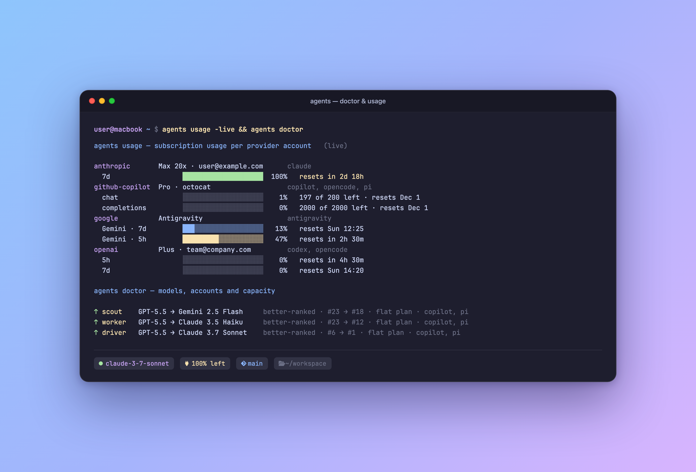

<div align="center">

# agents

**Universal AI Agent Harness Manager.**  
Parity compiler, layered prompt engine, workspace MCP synchronizer, live multi-provider quota tracking, and health diagnostics.

[](https://github.com/giocaizzi/agents/releases/latest)
[](https://github.com/giocaizzi/agents/actions/workflows/ci.yml)
[](LICENSE)

<p align="center">
  
</p>

</div>

Developers frequently switch between AI coding harnesses—**Claude Code, GitHub Copilot CLI, Google Antigravity, OpenAI Codex, OpenCode, and Pi**. Each requires its own configuration formats, permission settings, subagent models, and MCP wiring.

`agents` provides a single declarative source of truth (`agents.toml`), automatically compiling native configurations, tracking token quotas across providers, synchronizing MCP servers, and monitoring tool health.

---

## Highlights

- **Multi-Harness Parity**: Compile declarative security rules, command allowlists, LSP language servers, and subagent models into native JSON/TOML configurations for 6 harnesses.
- **Bounded Harness Clamping**: Intelligently adapts models for bounded harnesses like GitHub Copilot CLI where arbitrary tier models (e.g. Claude Opus) are unavailable.
- **Layered Prompt Engine**: Compose system prompts dynamically from modular instruction layers with support for custom profiles (`[profiles.work]`, `[profiles.default]`).
- **Workspace MCP Sync**: Keep workspace `.mcp.json` definitions synchronized across Codex, Pi, and Antigravity configs automatically.
- **Live Provider Usage & Quota**: Inspect real-time subscription usage, billing limits, and reset dates across Anthropic, OpenAI, GitHub Copilot, and Google Gemini.
- **Health Doctor**: Diagnose model drift against LMArena rankings, detect orphaned plugins, and audit missing system dependencies.
- **Sub-5ms Status Line**: Native Go status bar hook for Claude Code, Copilot CLI, tmux, and oh-my-posh.
- **Abstract Plugin Engine**: Support for multiple registries (community, company, personal) alongside standalone external plugins, with automated update, prune, and parity checks.

---

## Quickstart

### 1. Install

```bash
# Via Go
go install github.com/giocaizzi/agents/cmd/agents@latest

# Prebuilt binary (macOS / Linux / Windows)
curl -fsSL https://raw.githubusercontent.com/giocaizzi/agents/main/install.sh | sh
```

### 2. Initialize

Run in your project root or home directory to detect installed harnesses and scaffold an initial configuration:

```bash
agents init
```

This generates `agents.toml`:

```toml
[agents]
harnesses = ["claude", "copilot", "antigravity", "codex", "opencode", "pi"]
theme     = "dark"

[models]
driver    = "claude-3-7-sonnet"
scout     = "gemini-2.5-flash"
routine   = "claude-3-5-haiku"
escalate  = "claude-3-opus"

[tools]
deny      = ["rm -rf", "sudo", "git push --force"]
allow     = ["git status", "git diff", "make", "cargo test", "uv run"]

[lsp]
pyright   = { command = "pyright-langserver", languages = ["python"] }
gopls     = { command = "gopls",              languages = ["go"] }
ts        = { command = "typescript-language-server", languages = ["typescript", "javascript"] }

[mcp]
filesystem = { command = "npx", args = ["-y", "@modelcontextprotocol/server-filesystem", "."] }
fetch      = { command = "uvx", args = ["mcp-server-fetch"] }

[profiles.default]
instructions = ["prompts/core.md", "prompts/principles.md"]

[profiles.work]
instructions = ["prompts/core.md", "prompts/work.md"]
[profiles.work.models]
driver       = "claude-3-7-sonnet"
[profiles.work.permissions]
deny         = ["git push --force", "terraform apply", "rm -rf"]

[plugins]
# Primary or upstream plugin registry:
registry = "https://github.com/example/harness"
enabled  = { dev-tools = ["claude", "antigravity", "codex", "pi"], python = ["claude", "antigravity"] }

# Standalone external plugins ensured across harnesses (not bound to any registry):
[plugins.standalone.custom-analysis]
source    = "https://github.com/example/custom-analysis"
harnesses = ["claude", "antigravity"]
```

### 3. Verify & Apply

```bash
# Check parity across all installed harnesses
agents check

# Render client-native configuration or effective system prompt
agents render -harness claude
agents render -harness claude -part prompt

# Inspect or validate effective harness prompt
agents prompt -harness antigravity -check

# Sync workspace MCP servers
agents mcp sync

# Check account usage and quotas (always live; refreshes the usage cache)
agents usage

# Run health diagnostics
agents doctor
```

---

## Chezmoi Integration

`agents` operates as a standalone tool, but also functions as a first-class **chezmoi plugin**.

When installed as `chezmoi-agents` (or symlinked in `~/.local/bin`), chezmoi automatically routes `chezmoi agents ...` commands to the binary. When executed in a chezmoi directory, it automatically resolves templates and data from `.chezmoidata/agents.toml`.

---

## Commands Reference

| Command | Arguments | Description |
|---|---|---|
| `init` | `[-global] [-dir <path>]` | Probe installed harnesses and scaffold `agents.toml` |
| `statusline` | `[claude│copilot│tmux│omp]` | High-speed (<5ms) Catppuccin status bar output |
| `check` | `[-file <path>]` | Validate configuration, parity, and plugin health |
| `render` | `-harness <name> [-part <type>]` | Compile native configuration JSON/TOML or harness prompt |
| `prompt` | `[-harness <name>] [-profile <name>]` | Display or validate effective harness system prompt |
| `mcp sync` | `[path]` | Synchronize workspace `.mcp.json` to harnesses |
| `models` | `[sync│render]` | Inspect LMArena ranks, Epoch ECI, and pricing |
| `usage` | `[-provider <id>]` | Live subscription usage per provider account; writes the usage cache |
| `doctor` | `[-q] [-json] [-harness <list>]` | Advisory on model capacity, drift, and accounts; reads the usage cache only |
| `plugins` | `[list│update│prune]` | Cross-harness plugin lifecycle management |

When no plugin directory is specified, automatic discovery prefers the managed installation at `~/.local/share/<registry-namespace>` before working-directory, `~/Documents`, and `~/src` developer checkouts. Pass `-harness-dir <path>` or set `HARNESS_DIR` to use a specific directory instead.

`agents plugins list` fetches the checkout's remote tip and reads upstream versions from it, without touching the working tree. When the remote is unreachable it falls back to the local checkout, marks those versions with `?` and warns that they may be out of date.

`agents usage` always queries every provider and rewrites the usage cache; a provider that fails keeps its last cached values, marked stale with the error. `agents statusline` and `agents doctor` only read that cache, so they stay fast and offline.

---

## License

[MIT](LICENSE) © Giorgio Caizzi
